<div align="center">

<!-- HEADER BANNER -->


<!-- TYPING ANIMATION -->
[](https://git.io/typing-svg)

<br/>

<!-- PROFILE VIEWS & CONNECT BADGES -->

[](https://linkedin.com)
[](mailto:your@email.com)

</div>

---

## 🧩 Who Am I?

```yaml
Name       : Abdullah Aejaz Baig
Roles      : Business Analyst | Project Manager | QA Tester
Focus      : Bridging the gap between stakeholders and development teams
Superpower : Translating ambiguity into clarity — and chaos into delivery
```

> *"Requirements don't fail projects. Misunderstood requirements do."*

I operate at the intersection of **business strategy**, **technical execution**, and **quality assurance** — where most projects either succeed or fall apart. My job is to make sure they succeed.

---

## ⚡ What I Do

<div align="center">

| 🔍 Business Analysis | 📋 Project Management | 🧪 QA & Testing |
|:---:|:---:|:---:|
| Requirements Elicitation | Agile / Scrum / Kanban | Test Planning & Strategy |
| Process Mapping (BPMN) | Sprint Planning & Delivery | Manual & Exploratory Testing |
| Gap & Impact Analysis | Risk Management | Bug Lifecycle Management |
| Stakeholder Communication | Resource Allocation | UAT Coordination |
| BRD / FRD / SRS Writing | Roadmap Management | Regression Testing |

</div>

---

## 🛠️ Tools & Technologies

<!-- BA Tools -->
**Business Analysis**


<!-- PM Tools -->
**Project Management**


<!-- QA Tools -->
**Quality Assurance**


---

## 📈 My Approach

```mermaid
graph LR
    A[🎯 Understand Business Need] --> B[📝 Gather Requirements]
    B --> C[📊 Analyze & Document]
    C --> D[🗺️ Plan Execution]
    D --> E[🔁 Manage Delivery]
    E --> F[🧪 Test & Validate]
    F --> G[✅ Go Live]
    G --> H[🔄 Retrospect & Improve]

    style A fill:#7F77DD,color:#EEEDFE
    style B fill:#534AB7,color:#EEEDFE
    style C fill:#3C3489,color:#EEEDFE
    style D fill:#26215C,color:#EEEDFE
    style E fill:#3C3489,color:#EEEDFE
    style F fill:#534AB7,color:#EEEDFE
    style G fill:#7F77DD,color:#EEEDFE
    style H fill:#AFA9EC,color:#26215C
```



---

## 🤝 Let's Connect

<div align="center">

[](https://linkedin.com/in/abdullahaejazbaig/)
[](mailto:abdullahaejazbaig@gmail.com)

*Open to collaborations, consulting, and opportunities where clarity and quality matter.*

</div>

---

<div align="center">


</div>
